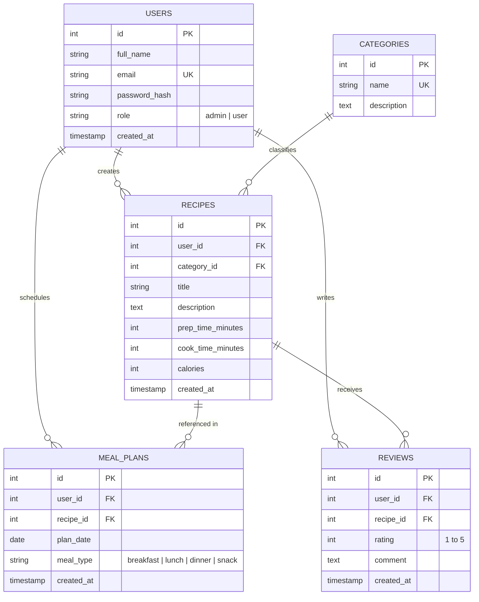

# Recipe & Meal Prep Tracker

A responsive single-page web application (SPA) designed for organizing personal recipes, scheduling weekly meal plans, tracking nutritional intake, and discovering new dishes. Developed as part of the Web Programming course (IT 2001).

---

## 📌 Project Description

The **Recipe & Meal Prep Tracker** provides a central platform for users to manage food preparation workflows, browse recipe catalogs, schedule daily meals, and rate recipes. The application features dynamic client-side rendering as a Single-Page Application (SPA) with a FlightPHP RESTful backend architecture, role-based authorization, and external API integration.

---

## 🛠️ Technology Stack

* **Frontend:** HTML5, CSS3, Bootstrap 5.3, JavaScript (ES6+), jQuery
* **Backend:** PHP 8.2+, FlightPHP Framework (REST API)
* **Database:** MySQL / MariaDB (PHP PDO data access layer)
* **Documentation:** OpenAPI / Swagger UI
* **External API:** TheMealDB API

---

## 📁 Project Structure

```text
IT-2001-Web-Programming--Ahmad-Alabd-Alomar/
├── .gitignore
├── README.md
├── AGENTS.md
├── docs/
│   └── AI_LOG.md
├── backend/
│   ├── config/
│   │   └── config.example.php
│   ├── dao/
│   ├── logs/
│   │   └── .gitkeep
│   ├── middleware/
│   ├── routes/
│   └── services/
└── frontend/
    ├── css/
    │   └── styles.css
    ├── js/
    │   └── app.js
    ├── views/
    │   ├── dashboard.html
    │   ├── external-api.html
    │   ├── login.html
    │   ├── meal-plans.html
    │   ├── profile.html
    │   ├── recipes.html
    │   └── register.html
    └── index.html
```

---

## 🗄️ Database Entities & Relationships

The database schema consists of 5 core entities managing account access, recipe data, meal planning, and ratings.

### Identified Entities
1. **`users`**: Account management and authentication supporting role-based permissions (`admin` vs `user`).
2. **`categories`**: Food classifications (e.g., Breakfast, Lunch, Dinner, Vegan, Dessert).
3. **`recipes`**: User-created recipes containing ingredients, cooking instructions, prep time, and calories.
4. **`meal_plans`**: Scheduled meal planner entries mapping recipes to specific days of the week and meal times.
5. **`reviews`**: Ratings (1–5 stars) and feedback submitted by users for specific recipes.

### Entity-Relationship Diagram (ERD)



---

## 👥 User Roles & Test Accounts

The application enforces 2 distinct access roles:
* **Admin:** Full CRUD access over all entities, category management, and user oversight.
* **User:** Access restricted to creating personal recipes, managing personal meal plans, writing reviews, and searching external recipes.

| Role | Email | Password | Access Level |
| :--- | :--- | :--- | :--- |
| **Admin** | `admin@recipetracker.com` | *(To be seeded in M2)* | Full System Access |
| **User** | `user@recipetracker.com` | *(To be seeded in M2)* | Restricted User Access |

---

## 🌐 External API Integration

* **API Provider:** [TheMealDB API](https://www.themealdb.com/api.php)
* **Supported Feature:** **Recipe Search & Discovery (`#external-api`)** — Allows users to query an external public recipe database, inspect ingredients/instructions, and import external recipes into local meal prep schedules.

---

## 🚀 Local Setup Instructions

### Prerequisites
* XAMPP / WAMP / MAMP environment (Apache web server, PHP 8.2+, MySQL / MariaDB)
* Web Browser (Chrome, Firefox, Edge)

### Installation Steps
1. **Clone the Repository** into your local Apache web server directory (`htdocs`):
   ```bash
   cd C:\xampp\htdocs
   git clone https://github.com/ibu-web-programming2001/IT-2001-Web-Programming--Ahmad-Alabd-Alomar.git
   ```

2. **Configure Database & Secrets:**
   * Navigate to `backend/config/`.
   * Create a local configuration file from the template:
     * **Windows (CMD):** `copy backend\config\config.example.php backend\config\config.php`
     * **Bash / Mac:** `cp backend/config/config.example.php backend/config/config.php`
   * Open `backend/config/config.php` and set your local MySQL credentials.

3. **Import Database Schema (Milestone 2 Deliverable):**
   * Open phpMyAdmin (`http://localhost/phpmyadmin/`) or DBeaver.
   * Create a database named `recipe_tracker`.
   * Import the database SQL script once generated in Milestone 2.

4. **Access the Application:**
   * Ensure Apache and MySQL are running in the XAMPP Control Panel.
   * Open your browser and navigate to:
     ```text
     http://localhost/AhmadAlomarWP/IT-2001-Web-Programming--Ahmad-Alabd-Alomar/frontend/index.html
     ```

---

## 🔗 Links & Resources

* **OpenAPI / Swagger Documentation:** *(Pending Milestone 3)*
* **Live Deployed Application:** *(Pending Milestone 5)*